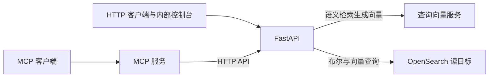

# patent-search-2.0

专利检索服务，支持按关键词、语义和组合条件检索专利，并查询专利详情、引证及法律状态历史。提供 HTTP API、MCP 工具和内部网页控制台，供业务系统集成与检索人员使用。

## 提供的能力

- `POST /api/patent/search`：布尔、向量、布尔与向量混合检索；支持分页和日期排序。
- 专利详情、引证、法律状态历史三个读取接口。
- 支持标题、摘要、首项权利要求、完整权利要求、说明书、独立权利要求和从属权利要求检索，并根据检索内容匹配中英文字段；支持申请人、发明人、IPC 分类等查询条件。
- MCP 提供 6 个工具，通过 HTTP API 访问服务，不直接查询 OpenSearch。
- `/console/`：内部检索界面；`/admin/`：运行指标、日志、配置草案及受限的单实例参数应用/回滚。
- `/live`、`/startup`、`/ready` 探针及 `/metrics` 指标。

HTTP API 使用 `X-API-Key`，MCP 使用 Bearer Token，Console 和管理员入口分别使用 Basic 身份认证。浏览器和指标入口应配置可信网络与相应访问控制。

语义检索支持摘要、首项权利要求和独立权利要求，接口字段名分别为 `abstract`、`main_claim`、`independent_claims`。检索结果取决于目标索引中对应向量字段的数据覆盖情况，详见[向量与混合检索](docs/vector_search.md)。

## 架构与职责



FastAPI 负责查询解析、检索和响应映射；MCP 通过 HTTP API 调用 FastAPI。原始数据解析、入库和回填由独立数据流程负责。

`OPENSEARCH_INDEX` 默认使用稳定读别名 `patent_search_read`。切换别名不会同步数据或创建回滚副本，步骤见[索引切换](docs/ops/index_cutover.md)。

`app/integrations/patenthub_adapter.py` 提供工具层适配，可显式选择自托管 API 或外部 PatentHub；自托管请求失败时不会自动切换供应商。

服务版本见 [app/version.py](app/version.py)，依赖版本见 [requirements.txt](requirements.txt)，版本变更见 [CHANGELOG.md](CHANGELOG.md)。

## 本地开始

服务基于 FastAPI 和 OpenSearch，使用 Python 3.11；`make check` 的前端检查还需要 Node.js。

```sh
python3 -m venv .venv
source .venv/bin/activate
pip install -r requirements.txt
cp .env.example .env
make check
```

启动前按 `.env.example` 填写本环境的 OpenSearch、鉴权及三个必填并发准入参数。语义检索另需查询向量 API Key 和模型 endpoint 配套配置；示例中的空值不能直接用于启动。

```sh
make run
```

本地 `.env`、令牌和真实运行数据不提交到仓库。部署方式见[部署手册](docs/ops/deployment_runbook.md)。

## 目录与文档

| 路径 | 用途 |
|---|---|
| `app/` | FastAPI、查询解析、DSL、OpenSearch 读取、响应映射及控制台。 |
| `mcp_server/` | MCP 传输和 HTTP 客户端。 |
| `tests/` | 单元、契约及前端测试。 |
| `benchmarks/` | 性能测试与检索验证工具。 |
| `scripts/` | smoke 和运维检查工具。 |
| `deployment/` | systemd、Prometheus、告警及 OpenSearch 排序管道资产。 |
| `docs/` | 接口、开发与运维说明。 |

- [接口文档](docs/api.md)：HTTP/MCP 参数、查询语法、返回值及错误。
- [向量与混合检索](docs/vector_search.md)：向量字段、查询流程和排序管道。
- [开发说明](docs/development.md)与[完整文档目录](docs/README.md)。
